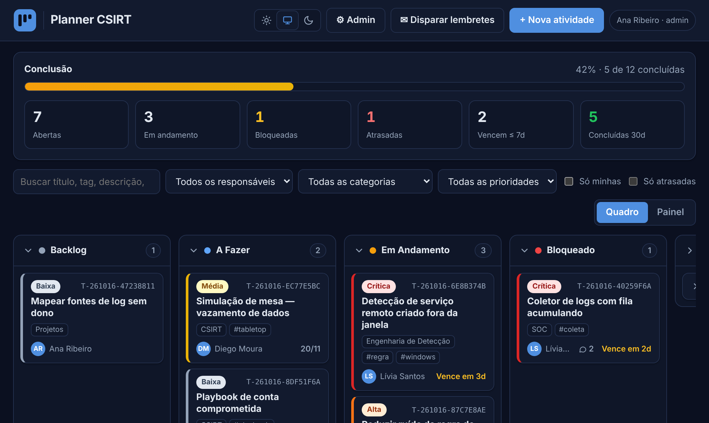
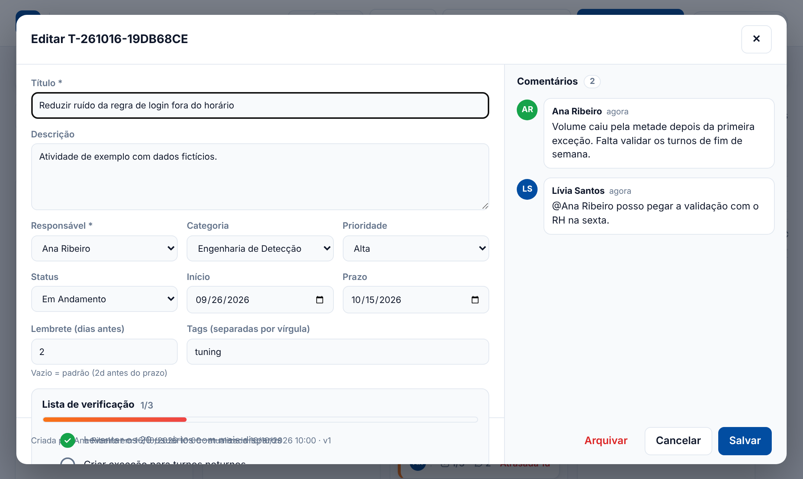
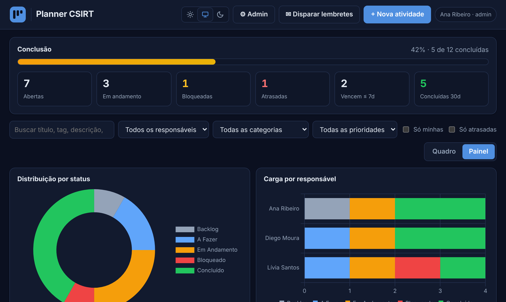

# Planner CSIRT

 

**Kanban de atividades para times, rodando 100% no Google Workspace — sem licença extra.**

O Google Workspace não tem um equivalente nativo ao MS Planner. Em vez de contratar mais uma ferramenta SaaS, este projeto entrega um planner completo com **Google Apps Script + Google Sheets**: quadro Kanban, lista de verificação, comentários com @menção, lembretes por e-mail, painel de métricas, gestão de acesso com aprovação por e-mail e importação do MS Planner.



## Funcionalidades

- **Quadro Kanban** com arrastar e soltar (Backlog → A Fazer → Em Andamento → Bloqueado → Concluído), colunas recolhíveis e filtros (responsável, categoria, prioridade, "só minhas", "só atrasadas")
- **Lista de verificação** por atividade (estilo MS Planner) — concluir, editar, reordenar, progresso no card
- **Comentários** com @menção e notificação por e-mail
- **Lembretes automáticos**: digest diário por responsável (vencendo / atrasadas / bloqueadas) + resumo semanal ao gestor
- **Painel**: distribuição por status, carga por pessoa, % de conclusão por categoria e por pessoa, throughput semanal
- **Gestão de acesso**: solicitação pelo próprio portal, aprovação por e-mail (botões Aprovar/Reprovar) ou painel Admin
- **Importação do MS Planner** (`.xlsx`/`.csv` do "Exportar plano para o Excel"), idempotente
- **Tema claro / escuro / sistema**, sincronizado por usuário
- **Auditoria** de todas as ações numa aba própria

| Atividade (tema claro) | Painel (tema escuro) |
|---|---|
|  |  |

## Segurança (resumo)

- Web app **executa como o dono** com acesso restrito ao **domínio** — a planilha não é compartilhada; o script é o único writer, então RBAC, validação e auditoria não podem ser contornados editando o Sheet.
- Autorização por papel (`admin`/`membro`) na aba Equipe; funções de operação protegidas contra chamada via `google.script.run`.
- Concorrência com `LockService` + **versionamento otimista** (conflito explícito em vez de *last-write-wins*).
- Neutralização de *formula/CSV injection* em todas as gravações; escape de HTML no cliente e nos e-mails; JSON embutido em template sanitizado.
- Aprovação de acesso por e-mail usa **página de confirmação** (o GET não decide) — imune a *prefetch* de scanners de link (Safe Links, Proofpoint etc.).
- Exclusões são *soft delete*; toda mutação vai para a aba Auditoria.

## Personalizar o logo

O projeto vem com um ícone genérico. Para usar a sua marca, troque `--logo-light` e `--logo-dark` no início de `src/Styles.html` por *data URIs* (PNG ou SVG) — uma versão para fundo claro e outra para fundo escuro.

## Deploy com clasp (opcional)

```bash
npm i -g @google/clasp && clasp login
cd src && clasp create --type standalone --title "Planner CSIRT"
clasp push -f        # depois rode setup() no editor e implante como App da Web
```

Web App (HtmlService) com Google Sheets como datastore: quadro Kanban drag & drop, painel com gráficos (Chart.js), barra de % de conclusão, KPIs, lembretes por e-mail (digest diário por responsável + resumo semanal ao gestor), RBAC e trilha de auditoria.

## Arquivos

| Arquivo | Papel |
|---|---|
| `src/Code.gs` | Backend: setup, API, RBAC, lock/versionamento, lembretes |
| `src/Index.html` | Shell da página (templated) |
| `src/Styles.html` | CSS (light/dark automático) |
| `src/App.html` | Cliente: quadro, filtros, modal, comentários, gráficos, Admin, importador |
| `src/Acesso.html` | Páginas "Solicitar acesso" e "Confirmar decisão" |
| `src/appsscript.json` | Manifesto: escopos mínimos + webapp `USER_DEPLOYING` / `DOMAIN` |

## Deploy

1. `script.google.com` → **Novo projeto** (standalone, com a sua conta Google Workspace).
2. Crie os arquivos com **os mesmos nomes** (`Index`, `Styles`, `App` como HTML; `Code` como script). Em *Configurações do projeto* marque "Mostrar arquivo de manifesto" e cole o `appsscript.json`.
3. No editor, rode **`setup()`** → autorize. O log imprime a URL da planilha `Planner CSIRT — DB` (criada no seu Drive) e o trigger diário é instalado.
4. Na planilha:
   - **Equipe**: `nome | email | papel (admin/membro) | ativo (TRUE/FALSE)`. Seu e-mail entra como admin automaticamente.
   - **Config**: `categorias`, `lembreteDiasPadrao`, `horaLembrete`, `emailGestor` (CSV), `resumoSemanalGestor`, `notificarAtribuicao`, `urlPortal`.
5. **Implantar → Nova implantação → App da Web** — *Executar como: Eu*; *Quem tem acesso: qualquer pessoa no domínio*. Copie a URL `/exec` para `Config.urlPortal` (link usado nos e-mails).
6. Mudou `horaLembrete`? Rode `reinstallTriggers()`.
7. Ícone da aba (opcional): suba um PNG quadrado (64×64) no Drive, compartilhe como "Qualquer pessoa com o link" e cole em `Config.faviconUrl` a URL `https://drive.google.com/thumbnail?id=ID_DO_ARQUIVO&sz=w64`. Publique uma Nova versão. (O Web App roda num iframe sandbox; `<link rel="icon">` no HTML não funciona — só `setFaviconUrl`.)
8. Embed no Google Sites: *Inserir → Incorporar → URL* com a `/exec` (`XFrameOptionsMode.ALLOWALL` já habilitado).


## Decisões de arquitetura

- **Execute as owner + acesso DOMAIN.** A planilha **não é compartilhada** com o time; o script é o único writer. Isso garante que RBAC (aba Equipe), validação e auditoria não sejam bypassados editando o Sheet direto. `USER_ACCESSING` exigiria editor no Sheet para todos → integridade perdida. Trade-off: owner da planilha/script é SPOF — transfira para conta de serviço/Shared Drive do time quando sair do piloto.
- **Identidade:** `Session.getActiveUser()` retorna e-mail só para usuários do mesmo domínio Workspace. Fora disso, acesso negado.
- **Funções públicas expostas.** Tudo sem `_` é invocável via `google.script.run`. `setup`/`runReminders`/`reinstallTriggers` têm `guardOwner_()` (active ≠ effective → throw). `apiRunRemindersNow` exige papel admin.
- **Concorrência:** `LockService.getScriptLock()` em toda escrita + **versionamento otimista** (`versao`). Edição sobre versão stale retorna `CONFLITO` e o cliente recarrega — sem last-write-wins silencioso. Drag & drop é otimista com rollback.
- **Formula/CSV injection:** todo campo de texto gravado com prefixo `'` (literal). Também evita autoconversão de string em data. Escape HTML no cliente e nos e-mails.
- **Soft delete:** "Arquivar" marca `arquivado=TRUE`; nada é removido. Toda mutação vai para a aba **Auditoria** (usuário, ação, ID, diff de campos).
- **Lembretes:** trigger diário → **um digest por responsável** (atrasadas, vencendo dentro da janela, bloqueadas). Dedupe por `ultimoLembrete` (no máx. 1 e-mail/pessoa/dia, inclusive com disparo manual). `ultimoLembrete` é marcado só após envio OK e **sem bump de versão** (não gera conflito para quem está editando). Janela por tarefa (`lembreteDias`) ou padrão da Config.
- **Quota MailApp:** consumidor ≈100 destinatários/dia; Workspace ≈1.500/dia. O digest consolidado mantém o consumo ≈ nº de pessoas/dia. Quota restante é logada a cada execução.
- **Notificações imediatas:** e-mail ao novo responsável quando atribuído por outra pessoa; e-mail ao gestor quando um item entra em **Bloqueado**.
- **Escala:** leitura full-scan da aba a cada chamada; confortável até alguns milhares de linhas. Acima disso, rotacionar concluídas/arquivadas para uma aba `Historico` ou BigQuery e cachear `apiListTasks` com `CacheService`.

## Comentários

- Painel lateral no modal de cada atividade existente; contador 💬 no card.
- Aba própria **`Comentarios`** (`id | taskId | autor | texto | criadoEm | editadoEm | excluido`), criada automaticamente na primeira gravação (não precisa rodar `setup()` de novo).
- **Desacoplado da atividade:** comentar não altera `versao`/`atualizadoEm`, então nunca gera `CONFLITO` com quem está editando o formulário.
- **@menção** pela parte local do e-mail (`@carlos.quintas`) com autocomplete da aba Equipe; mencionado sempre recebe e-mail ("Você foi mencionado…").
- **Notificação** (`Config.notificarComentario`): responsável + criador recebem e-mail a cada comentário novo; autor nunca é notificado do próprio comentário; só membros ativos.
- **Permissões:** editar = só o autor; excluir = autor ou admin. Exclusão é **soft delete** (`excluido=TRUE`, texto preservado); toda ação gera `COMMENT_ADD/EDIT/DELETE` na Auditoria (edição registra antes → depois).
- **Segurança:** texto escapado antes de renderizar; links só `http/https` com `rel="noopener noreferrer"`; gravação com prefixo `'` (sem formula injection); limite de 5.000 caracteres; atividade arquivada bloqueia novos comentários.
- UX: Ctrl+Enter envia; rascunho preservado por atividade ao fechar o modal; thread atualiza a cada 20 s enquanto o modal está aberto (sem atropelar edição em curso).

## Tags coloridas

- Catálogo de tags na aba **Tags** (`nome | cor | criadoPor | criadoEm`), no estilo dos rótulos do MS Planner. No formulário, "+ Tag" abre um seletor com busca: clicar seleciona/desmarca; digitar um nome novo mostra a paleta para **criar a tag já com a cor**; 🎨 troca a cor de uma tag existente (vale para todas as atividades); 🗑 exclui (somente admin — remove a tag de todas as atividades, com auditoria).
- Paleta fixa de 12 cores, todas com contraste AA (≥ 4,5:1) com texto branco nos temas claro e escuro; o servidor só aceita cores da paleta (sem injeção de CSS).
- Atividades guardam os nomes na coluna `tags`; nomes são normalizados (sem `#`, sem duplicata ignorando acento/caixa, grafia do catálogo), máximo de 10 por atividade. Tags digitadas/importadas que não existem entram no catálogo com cor automática. Filtro "Todas as tags" no quadro. Auditoria: `TAG_CREATE/COLOR/DELETE`.

## Co-responsáveis

- Além do **responsável principal**, cada atividade aceita até 10 **co-responsáveis** (membros ativos), escolhidos por chips no formulário. Coluna `coResponsaveis` na aba Atividades (e-mails separados por `;`), criada automaticamente.
- Todos os responsáveis contam igual em "Só minhas", no filtro por responsável, nos gráficos/percentuais por pessoa, no digest diário de lembretes, nas notificações de comentário e no resumo semanal ao gestor.
- E-mail de atribuição vai só para quem **entrou** na atividade (principal ou co) — editar outros campos não reenvia. O principal nunca fica duplicado na lista de co.
- Card mostra os avatares empilhados (até 3 + "+N"). Remover um membro com reatribuição substitui a pessoa também onde ela é co-responsável. A importação do MS Planner leva todos os atribuídos (1º = principal, demais = co).

## Colunas recolhíveis

- Clique no cabeçalho de qualquer coluna (ou Enter/Espaço com foco) para recolher/expandir. Recolhida, a coluna mostra um resumo clicável — em Concluído, "› Tarefas concluídas · N", como no MS Planner.
- Padrão: **Concluído** começa recolhida. A escolha de cada usuário fica salva no navegador (`localStorage`).
- Coluna recolhida continua aceitando arrastar e soltar; o aviso indica que o card foi para uma coluna recolhida.

## Lista de verificação

- Bloco "Lista de verificação" no modal da atividade (como no MS Planner): círculo para concluir, clique no texto para editar, ✕ para remover, arrastar ⋮⋮ (ou Alt+↑/↓) para reordenar, campo "Adicionar um item" com Enter mantendo o foco para digitar em sequência. Barra de progresso e contador `2/5`; o card mostra ☑ `2/5` (verde quando completo).
- **Gravação imediata por item**, em aba própria `Checklist` (`id | taskId | texto | feito | ordem | criadoPor | criadoEm | feitoPor | feitoEm | excluido`). Não altera `versao` da atividade → marcar item nunca gera CONFLITO com quem está com o formulário aberto. Tooltip mostra quem concluiu e quando.
- Atividade nova: itens ficam em rascunho e são gravados em lote logo após o "Salvar".
- Qualquer membro ativo edita a lista; atividade arquivada bloqueia; limite de 50 itens / 300 caracteres; exclusão = soft delete; Auditoria `CHECK_ADD/DONE/UNDONE/EDIT/REORDER/DELETE`; atualização automática a cada 20 s com o modal aberto (sem atropelar edição/arraste em curso).
- **Importação do Planner** agora traz os itens reais da lista. O export só informa *quantos* foram concluídos (ex.: `1/3`), não *quais*: se todos → todos marcados; se nenhum → nenhum; se parcial → itens desmarcados + nota na descrição para marcar manualmente.

## Gestão de acesso

- Usuário do domínio que **não** está ativo na Equipe vê a página **Solicitar acesso** (nome + justificativa). Fora do domínio: bloqueado.
- Admins ativos recebem e-mail com botões **✔ Aprovar / ✖ Reprovar**. O botão abre o portal em `?acao=decidir&req=R-…&d=…` com uma **página de confirmação**; a decisão só é gravada no clique de confirmação (`google.script.run`).
  - Motivo: gateways (Microsoft Safe Links, Gmail, Proofpoint) fazem *prefetch* de links — um GET que aprovasse direto seria aprovado pelo scanner.
  - Autorização: sessão Google do admin + papel `admin` na Equipe. Link aberto por não-admin → "Apenas administradores".
- Decisão é única (o 2º admin recebe "já aprovada por X em Y"); aprovar cria/reativa o membro com o papel escolhido; solicitante recebe e-mail (com motivo na reprovação). Após reprovação há *cooldown* de 24h para nova solicitação; uma pendente por vez.
- Painel **⚙ Admin** (badge com pendentes): Solicitações (aprovar/reprovar com motivo e papel), **Membros** (papel, ativar/desativar, **remover**, adicionar direto — só e-mails do domínio). Travas: ninguém altera nem remove o próprio acesso; sempre ≥ 1 admin ativo.
- **Desativar × Remover:** desativar bloqueia o acesso e mantém a pessoa na lista (reativável); remover apaga a linha da aba Equipe. Em ambos o histórico (atividades, comentários, checklist, auditoria) é preservado. Na remoção, as atividades **abertas** podem ser reatribuídas a outro membro (concluídas mantêm o responsável original); removido/desativado não recebe lembretes. Auditoria: `MEMBER_REMOVE`.
- Aba `Solicitacoes` (`id | email | nome | justificativa | status | criadoEm | decididoPor | decididoEm | motivo`); Auditoria: `ACCESS_REQUEST/APPROVE/REJECT`, `MEMBER_ADD/UPDATE`.

## Importação do MS Planner

- Painel Admin → **Importar MS Planner** → selecione o `.xlsx` de *Exportar plano para o Excel* (ou `.csv`). Lido no navegador (SheetJS via cdnjs); a planilha original não sai do seu computador — só as atividades normalizadas vão para o Sheets.
- Reconhece cabeçalhos pt-BR e en-US e ignora as linhas de metadados do topo do export.
- Mapeamento: Progresso → status (Concluída sempre vira **Concluído**, preservando a data real de conclusão); bucket com nome de status (Bloqueado, Backlog, Em andamento…) vira o status; demais buckets → Categoria/Tag/Ignorar; Urgente→Crítica, Importante→Alta, Média, Baixa; Rótulos → tags; 1º atribuído → responsável, demais registrados na descrição; checklist resumido (ex.: `1/3`); data/criador originais preservados.
- Pessoas: auto-match por nome com a Equipe, ajustável na prévia; quem não for membro cai no responsável padrão e o nome original fica na descrição.
- **Idempotente:** `origemId = planner:<ID da tarefa>` (nova coluna em Atividades) — reimportar o mesmo arquivo não duplica. Gravação em lotes de 200 com um único `setValues` por lote; o servidor revalida tudo.

## Métricas

- **% de conclusão** = concluídas / total **do conjunto filtrado** (arquivadas fora). Filtrar por responsável/categoria recalcula a barra.
- KPIs: Abertas, Em andamento, Bloqueadas, Atrasadas, Vencem ≤ 7d, Concluídas 30d.
- Painel: distribuição por status, carga por responsável (stacked), % por categoria, % por responsável e throughput semanal (criadas × concluídas, 8 semanas).

## Limitações conhecidas

- Drag & drop HTML5 não funciona em touch; no mobile, mude o status pelo modal.
- Chart.js vem do `cdnjs`; se a política de rede bloquear, o painel mostra aviso e o quadro segue funcional.
- Throughput ignora tarefas arquivadas.
- Polling de 60s (sem push); conflitos são resolvidos pelo versionamento.


## Licença

Distribuído sob a licença **MIT** — veja [`LICENSE`](LICENSE). Use, adapte e redistribua à vontade, mantendo o aviso de copyright.

---

Desenvolvido por **Carlos Quintas** · SOC | CSIRT | SIEM Tech Leader · [LinkedIn](https://www.linkedin.com/in/carlosfpquintas)
